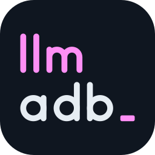

<div align="center">



# llm-adb

**Token-efficient ADB wrapper for LLM agents.**

<p>
  
  
  
  
  <a href="LICENSE"></a>
  <a href="https://github.com/codefl0w/llm-adb/stargazers"></a>
</p>

<p>
  <a href="#why-llm-adb">Why</a> &nbsp;·&nbsp;
  <a href="#performance--benchmark-results">Benchmarks</a> &nbsp;·&nbsp;
  <a href="#installation">Install</a> &nbsp;·&nbsp;
  <a href="#quick-start-for-llm-agents">Quick start</a> &nbsp;·&nbsp;
  <a href="#command-reference">Commands</a> &nbsp;·&nbsp;
  <a href="#structured-error-model--exit-codes">Errors</a>
</p>

</div>

---

`llm-adb` (CLI binary: `llmadb`) is a drop-in command-line wrapper around Android Debug Bridge (`adb`) built specifically for autonomous LLM coding and testing agents. Instead of forcing models to chain raw `adb shell` commands, parse multi-thousand-line `uiautomator` XML dumps, guess screen coordinates from full-resolution screenshots, or hang on 60fps animations, `llm-adb` collapses multi-step device interactions into single, deterministic calls with compact line-based output.

Any subcommand not owned by `llm-adb` passes through transparently to `adb` (`llmadb shell ...`, `llmadb install ...`, `llmadb logcat ...`), allowing agents to use `llmadb` as a complete replacement for `adb`.

### At a glance

| | Raw `adb` | `llm-adb` |
|---|---|---|
| **Reading the screen** | 15,000–50,000 byte XML dump | 15–40 line indexed tree (~100–250 tokens) |
| **Custom views, WebViews, games** | Guessing coordinates from full-resolution screenshots | Downscaled screenshot with a 100px device-coordinate grid |
| **Animations and overlays** | Dump hangs or fails; overlays missing | Fails fast, surfaces `! overlay` warnings |
| **Actions** | `input tap` returns nothing; extra turns to re-dump | Every action returns the settled UI |
| **Everything else** | `adb` | Transparent passthrough to `adb` |

---

## Why `llm-adb`?

When controlling an Android device with raw `adb`, LLM agents waste 30–60% of their tokens and turns on boilerplate plumbing:
- **Massive XML Dumps:** A single `adb shell uiautomator dump` produces 15,000–50,000 bytes of deeply nested XML. `llmadb ui` filters out invisible/zero-area containers, merges redundant single-child wrappers, strips repetitive package prefixes, and emits a 15–40 line indexed accessibility tree (~100–250 tokens).
- **Blind Coordinate Guessing:** When elements live inside custom Canvas views, games, or unexposed WebViews, models fail to guess pixel coordinates on `1080x2400` screenshots. `llmadb screen` downscales screenshots (default max-edge `960px`) while burning a crisp **100px device-coordinate grid** with interior `+` crosshairs directly onto the image so vision models can read exact device coordinates (`llmadb tap x,y`) in one shot.
- **Animation & Overlay Blindness:** Standard `uiautomator dump` hangs for up to 30 seconds or fails with `could not get idle state` when a countdown timer, progress spinner, or 60fps animation is active. Furthermore, floating system overlays (incoming calls, heads-up notifications, OxygenOS Dynamic Island / `SeedlingCard` capsules) are omitted when another window holds input focus. `llm-adb` fails fast on non-idle trees and cross-checks `dumpsys window` across Android 7 through Android 17 (`InputWindowHandle` and `InputDispatcher`) to surface `! overlay window="..." @cx,cy` warnings automatically.
- **Multi-Turn Action Loops:** Raw `adb shell input tap` returns nothing, requiring extra turns to sleep and re-dump the screen. Every `llmadb` action (`tap`, `type`, `swipe`, `key`) automatically waits for the UI to settle and returns the updated UI snapshot in a single tool call.

---

## How `llm-adb` Accelerates App Development & QA

`llm-adb` turns any tool-using LLM (Claude Code, Gemini CLI, Cursor, Windsurf, or local coding agents) into an autonomous Android QA and debugging engineer:

1. **Automated UI & Feature Verification:**
   After building and installing an APK (`llmadb install -r app-debug.apk`), an agent can launch the app (`llmadb launch com.example.app`), navigate onboarding flows (`llmadb tap --text "Get Started"`), fill forms (`llmadb type "user@example.com" --clear --enter`), and test long-press context menus (`llmadb tap --text "Item" --hold`).
2. **Deterministic Crash Reproduction & Log Triage:**
   Instead of sifting through thousands of noisy system logcat lines, agents run a tight reproduction loop:
   ```bash
   llmadb mark                                      # Save current device timestamp
   llmadb tap --id submit_btn                       # Trigger the bug
   llmadb log --pkg com.example.app --since-mark    # Inspect deduplicated app logs (xN)
   llmadb log --crash --since-mark                  # Extract fatal exception stack traces
   ```
3. **Orientation & Responsive Layout Testing:**
   Agents can toggle or lock screen orientation (`llmadb rotate landscape`, `llmadb rotate portrait`, or `llmadb rotate` to flip the current state) and immediately inspect `llmadb ui` or `llmadb screen` to verify that state survives configuration changes without layout clipping.
4. **Device Environment & Connectivity Auditing:**
   With `llmadb status` and `llmadb hardware`, agents instantly verify battery levels, Wi-Fi/Cellular connectivity, Bluetooth/NFC/Airplane states, DPI scaling, available RAM/storage, and SELinux/root status before running integration tests.
5. **Cross-Generation Compatibility (Android 7 to Android 17):**
   Tested across legacy OEM skins (Samsung Grace UX / Android 7.0), modern OEM skins (OnePlus OxygenOS 16 / Android 16), and stock AOSP (Google Pixel / Android 17), automatically handling edge-to-edge bottom navigation insets and OEM-specific window dumps.

---

## Performance & Benchmark Results

`llm-adb` was evaluated in a **Zero-Context ("Clueless") Autonomous Agent Benchmark** on a physical Android 16 device (`1080x2412`, 480 DPI) across frontier multimodal models and a local 35B MoE model. Agents were given zero prior documentation - learning `llm-adb` strictly via `llmadb --help-llm` at runtime - and compared against an unassisted **Raw `adb`** baseline under strict on-device UI rules (no host web scraping or deep-link shortcuts).

### 1. End-to-End Agent Benchmark Summary

| Task | Model | Raw `adb` Baseline | `llm-adb` (`llmadb`) | Improvement with `llm-adb` |
|---|---|---|---|---|
| **Launcher Navigation & Web Search (`TC-02`)** | **Local 35B-A3B MoE** (Text-Only) | `208.8s` (25 turns)<br>`12,545` uncached tokens<br>`166,071` total context | **`110.3s`** (17 turns)<br>**`8,565`** uncached tokens<br>**`103,056`** total context | **47.2% faster**<br>**31.7% fewer uncached tokens**<br>**50.5% fewer output tokens** |
| **Launcher Navigation & Web Search (`TC-02`)** | **Claude Sonnet 5.5** | `40.6s`<br>`106,764` total context<br>`1,875` output tokens | **`31.3s`**<br>**`83,376`** total context<br>**`1,224`** output tokens | **22.9% faster**<br>**21.9% fewer total tokens**<br>**34.7% fewer output tokens** |
| **Launcher Navigation & Web Search (`TC-02`)** | **Gemini 3.8 Flash** | `66.6s`<br>`221,262` total context<br>`1,251` output tokens | **`63.2s`**<br>**`159,175`** total context<br>**`635`** output tokens | **28.1% fewer total tokens**<br>**49.2% fewer output tokens** |
| **7-Stage Multi-App Flow (`TC-06`)**<br>*(Quick Settings -> Web Search -> APK Download & Install -> 20s Timer -> Dynamic Island Dismiss)* | **Gemini 3.8 Flash** | **FAILED** (`723.2s` T/O)<br>`364,506` uncached tokens<br>*(Mis-tapped link without grid; hung on Play Protect)* | **PASSED (7/7 stages)**<br>**`441.3s`**<br>**`254,405`** uncached tokens | **Passed vs. Failed**<br>**39.0% faster**<br>**30.2% fewer uncached tokens**<br>**65.3% fewer output tokens** |
| **7-Stage Multi-App Flow (`TC-06`)** | **Claude Sonnet 5.5** | **PASSED** (`695.4s`)<br>`163,746` uncached tokens<br>*(2 failed `pm install` calls + mis-tap)* | **PASSED (7/7 stages)**<br>**`498.8s`**<br>**`109,023`** uncached tokens | **28.3% faster (`-3m 16s`)**<br>**33.4% fewer uncached tokens**<br>**34.8% fewer input tokens** |

> Each cell is a single trial (`TC-02` was run 1–3 times per model and `TC-06` 1–2 times, against one Raw `adb` baseline run), so treat the percentages as indicative, not statistical. Every run, including the ones not shown here, is logged in [`AGENT_TESTS.md`](AGENT_TESTS.md).

### 2. Host CLI Execution Latency

`llm-adb` batches multiple shell queries into single delimited `adb shell` invocations, keeping host-side command overhead minimal:

| Command | Operation | Typical Latency |
|---|---|---|
| `llmadb current` | Batched focus, activity, rotation, and keyboard visibility | `~180–350 ms` |
| `llmadb rotate` | Read/toggle system rotation and verify orientation | `~200–400 ms` |
| `llmadb status` | Batched battery, Wi-Fi, cellular, BT, NFC, and airplane status | `~250–450 ms` |
| `llmadb info <pkg>` | Package version, SDK, permissions, launcher, and PID | `~250–500 ms` |
| `llmadb log --since-mark` | Timestamp mark lookup + deduplicated PID logcat | `~200–450 ms` |
| `llmadb list apps` | Package path classification (`user`, `system`, `vendor`, `product`) | `~400–800 ms` |
| `llmadb screen` | Screencap + 960px downscale + 100px coordinate grid | `~800–1400 ms` |
| `llmadb ui` | Accessibility dump + reduction + overlay check + cache | `~1.0–2.2 s` |
| `llmadb tap <target>` | Input tap/hold + animation pause + settled UI dump | `~1.2–2.4 s` |

---

## Installation

Requires **Python 3.9+** and `adb` on your system `PATH` (or set via the `LLMADB_ADB` environment variable).

```bash
# Install globally via pipx (recommended)
pipx install .

# Or install into your Python environment
pip install .

# Editable install with test dependencies
pip install -e ".[dev]"
```

Verify installation:
```bash
llmadb --version
llmadb devices
```

---

## Quick Start for LLM Agents

Add the output of `llmadb --help-llm` to your agent's system prompt or `CLAUDE.md` / `AGENTS.md`, or instruct your agent to run `llmadb --help-llm` at the start of a session:

```bash
llmadb --help-llm
```

### Typical Agent Workflow

```bash
# 1. Inspect connected device and status
llmadb devices
llmadb hardware
llmadb status

# 2. Dump compact UI hierarchy
llmadb ui
# Output:
# screen 1080x2400 app=com.google.android.apps.nexuslauncher rot=0 snap=1
# 1 text "Search" id=search_box @540,2180
# 2 text "YouTube" @200,1450
# 3 text "Chrome" @540,1450

# 3. Tap or long-press by element index, text, resource-id, or coordinates
llmadb tap 3                              # Tap element #3 (Chrome) and print settled UI
llmadb tap --text "YouTube" --hold        # Long-press YouTube (default 500ms) to open shortcut menu
llmadb tap --text "YouTube" --hold 1000   # Long-press YouTube for 1000ms

# 4. Type into focused input field
llmadb type "https://example.com" --clear --enter

# 5. Capture screenshot with 100px device coordinate grid (for WebViews/Canvas/games)
llmadb screen

# 6. Toggle or set screen rotation
llmadb rotate                             # Toggle between portrait (0) and landscape (1)
llmadb rotate portrait                    # Explicitly lock portrait

# 7. Clean up cached screenshots and snapshots
llmadb clear-cache
```

---

## Command Reference

### Global Options
```text
llmadb [--device SERIAL] [--timeout SECONDS] [--max-lines N] <command> [args...]
llmadb -- <adb-command> [args...]
```
- `-s, --device SERIAL`: Target device serial (also reads `LLMADB_SERIAL` or `ANDROID_SERIAL`).
- `--timeout SECONDS`: Command execution timeout in seconds.
- `--max-lines N`: Truncate stdout to `N` lines (appends `[truncated: M more lines]`).
- `--help-llm`: Print compact rules and command cheat-sheet for LLM context windows.
- `-h, --help`: Show CLI help.
- `-v, --version`: Show version.

---

### Device & System State

#### `llmadb devices`
List connected devices in clean TSV format (`serial`, `state`, `model`, `transport`).

#### `llmadb hardware [--json]`
Single-call batched hardware specification report: manufacturer, model, Android version, SDK level, security patch, CPU ABIs, SoC/platform, physical and effective resolution, DPI, RAM (`total_mb`, `available_mb`), `/data` storage, SELinux state, and root availability. Outputs compact `key: value` lines by default; pass `--json` for structured JSON.

#### `llmadb status [--json]`
Single-call device connectivity and power status report:
- `battery`: percentage and charging state (e.g. `85% (charging, ac)`)
- `wifi`: enabled/connected state and SSID
- `cellular`: SIM/radio state and network operator
- `bluetooth`, `nfc`, `airplane_mode`: `on` / `off`

#### `llmadb current`
Report foreground package/activity, display rotation (`0`–`3`), and software keyboard state (`visible` or `hidden`):
```text
com.android.chrome/com.google.android.apps.chrome.Main rot=0 keyboard=hidden
```

#### `llmadb rotate [0|1|portrait|landscape|auto]`
Control screen orientation and return the current rotation state (`rotation: 0 (portrait)` or `rotation: 1 (landscape)`):
- `llmadb rotate` (no args): Check current rotation and toggle to the opposite orientation (`0 <-> 1`), disabling `accelerometer_rotation`.
- `llmadb rotate 0` / `llmadb rotate portrait`: Lock to portrait (`user_rotation=0`).
- `llmadb rotate 1` / `llmadb rotate landscape`: Lock to landscape (`user_rotation=1`).
- `llmadb rotate auto`: Re-enable sensor auto-rotation (`accelerometer_rotation=1`).

#### `llmadb clear-cache [--all]`
Delete cached screenshots (`screens/*.png`), UI snapshots (`snap.json`), and logcat marks stored in the host user cache directory (`~/.cache/llmadb` or `%LOCALAPPDATA%\llmadb\Cache`). By default clears the active device's cache; pass `--all` to purge all device caches.

---

### Perception (`ui` & `screen`)

#### `llmadb ui [--full] [--bounds] [--compressed] [--raw]`
Dump and reduce the current accessibility hierarchy into indexed interactive/labeled elements:
```text
screen 1080x2400 app=com.android.settings rot=0 snap=4
! overlay window="NotificationShade" bounds=[42,96][1038,348] @540,222
1 text "Network & internet" @412,560
2 switch "Wi-Fi" id=switchWidget [checked] @948,560
```
- `--full`: Do not truncate long element labels at 120 characters.
- `--bounds`: Display full `[x1,y1][x2,y2]` bounding boxes instead of `@cx,cy` centers.
- `--compressed`: Pass `--compressed` to `uiautomator dump`.
- `--raw`: Output raw unparsed XML for debugging.

#### `llmadb screen [options]`
Capture a downscaled screenshot with a **100px device-coordinate grid** by default:
- `--grid N`: Draw device-pixel coordinate grid every `N` pixels (default: `100`).
- `--no-grid`: Disable grid overlay and draw numbered element bounding boxes from the UI tree instead.
- `--max-edge N`: Maximum long-edge resolution in pixels (default: `960`).
- `--element N`: Crop and 2x-upscale around element index `N` from the latest snapshot.
- `--region x1,y1,x2,y2`: Crop and 2x-upscale a specific device-coordinate rectangle.
- `--raw`: Save downscaled screenshot without any annotations or UI dump.
- `--no-ui`: Skip refreshing the UI snapshot before annotating.

---

### Interaction (`tap`, `type`, `swipe`, `key`, `wait-for`)

All interaction commands wait for the UI to settle after execution and print the updated `ui` output automatically (pass `--no-ui` to suppress, or `--diff` to print only `+` added and `-` removed elements).

#### `llmadb tap <target> [--hold [TIME]] [--snap N] [--diff] [--no-ui] [--wait-settle]`
Tap or long-press a target element:
- `llmadb tap 5`: Tap element `#5` from the latest cached snapshot.
- `llmadb tap --text "Sign in"`: Match element by exact text first, then case-insensitive substring.
- `llmadb tap --id login_button`: Match element by resource ID (`short_id` or full `pkg:id/name`).
- `llmadb tap 540,1200`: Tap explicit device pixel coordinates (always device space, never scaled image space).
- `--hold [TIME]`: Perform a long-press at the target coordinates (`input swipe x y x y <ms>`). `TIME` is optional and specified in milliseconds (defaults to `500` ms when omitted).
- `--snap N`: Guard against stale state by failing if the cached snapshot ID is not `N`.
- `--wait-settle`: Poll up to 3s for animations to finish before resolving `--text` or `--id`.

#### `llmadb type "<text>" [--clear] [--enter] [--diff] [--no-ui]`
Type ASCII text into the focused input field with automatic shell/metacharacter escaping:
- `--clear`: Select all (`CTRL+A`) and delete existing text in the focused field before typing.
- `--enter`: Send `KEYCODE_ENTER` (`66`) after typing.

#### `llmadb swipe <up|down|left|right|x1,y1 x2,y2> [--dist F] [--dur MS] [--diff] [--no-ui]`
Perform a directional or coordinate swipe gesture. Directional swipes automatically clamp start/end coordinates away from Android 10–17 system gesture insets.

#### `llmadb key <name|code> [--diff] [--no-ui]`
Send a hardware or navigation keyevent (`home`, `back`, `enter`, `tab`, `menu`, `power`, `volup`, `voldown`, `recents`, `delete`, or numeric Android keycode).

#### `llmadb wait-for <--text X|--id Y|--gone X> [--timeout S]`
Poll the UI hierarchy every 500ms until matching text/ID appears or `--gone` text disappears (default timeout: `10s`).

---

### App Management & Logcat

#### `llmadb list apps [user|system|vendor|product|all] [--grep S] [--disabled] [--enabled]`
List installed packages classified by partition path (default scope: `user`).

#### `llmadb info <pkg>`
Condensed package metadata: version name/code, `minSdk`/`targetSdk`, installer, debuggable flag, enabled state, running status with PID, main launcher component, and granted/denied runtime permissions.

#### `llmadb launch <pkg>` | `llmadb stop <pkg>` | `llmadb clear <pkg>`
Start an app's main launcher activity, force-stop a package (`am force-stop`), or wipe app data (`pm clear`).

#### `llmadb mark` & `llmadb log [--pkg P] [--level V|D|I|W|E|F] [-n 200] [--since-mark] [--crash] [--full]`
- `llmadb mark`: Record the device's current timestamp in the host cache.
- `llmadb log`: Query `logcat` with consecutive duplicate collapsing (`... x37`), PID filtering (`--pkg`), minimum severity (`--level`, default `W`), `--since-mark` filtering, and `--crash` buffer inspection.

---

### Transparent `adb` Passthrough

Any subcommand not listed above is forwarded directly to `adb` with automatic device serial resolution:
```bash
llmadb shell getprop ro.build.version.release
llmadb install -r app-debug.apk
llmadb pull /sdcard/Download/report.json .
llmadb -- devices   # Force raw 'adb devices' via '--' escape hatch
```

---

## Structured Error Model & Exit Codes

Errors are written exclusively to `stderr` in a single-line machine-parseable format with an actionable recovery hint:
```text
error: <CODE> <message> | hint: <recovery hint>
```

| Exit Code | Error Code(s) | Meaning |
|---|---|---|
| `0` | - | Success |
| `1` | `E_GENERIC` | Unexpected internal error |
| `2` | `E_USAGE`, `E_UNSUPPORTED` | Invalid CLI arguments or unsupported input (e.g., non-ASCII `type`) |
| `3` | `E_NO_DEVICE`, `E_MULTI_DEVICE` | No device connected, or multiple devices connected without `-s` |
| `4` | `E_DEVICE_STATE` | Device is `unauthorized` or `offline` |
| `5` | `E_TIMEOUT` | Command or `wait-for` condition timed out |
| `6` | `E_NOT_FOUND`, `E_AMBIGUOUS` | Target UI element or package not found, or multiple elements matched |
| `7` | `E_SECURE_OR_EMPTY` | `FLAG_SECURE` window or empty accessibility hierarchy |
| `8` | `E_ADB` | Underlying `adb` binary missing or failed |

---

## Running Tests

```bash
pytest
```

## License

See [LICENSE](LICENSE) for details.